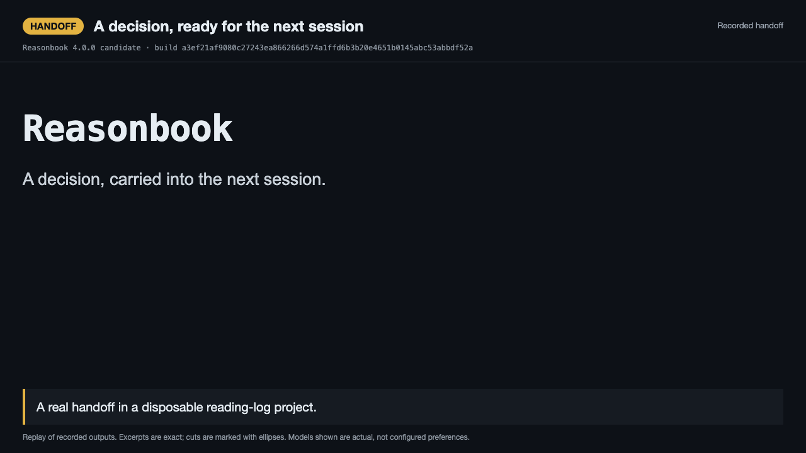
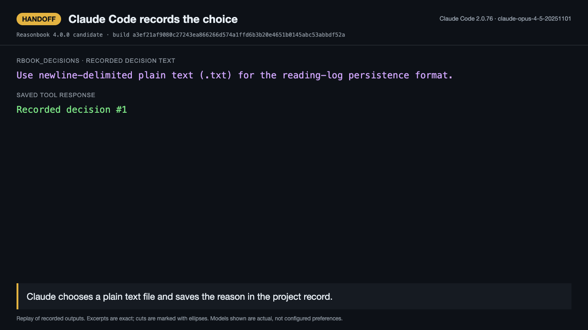
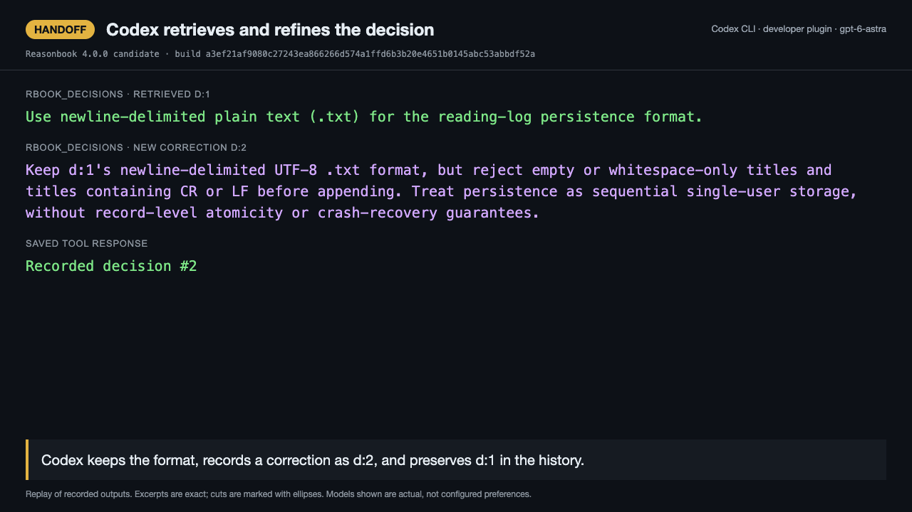
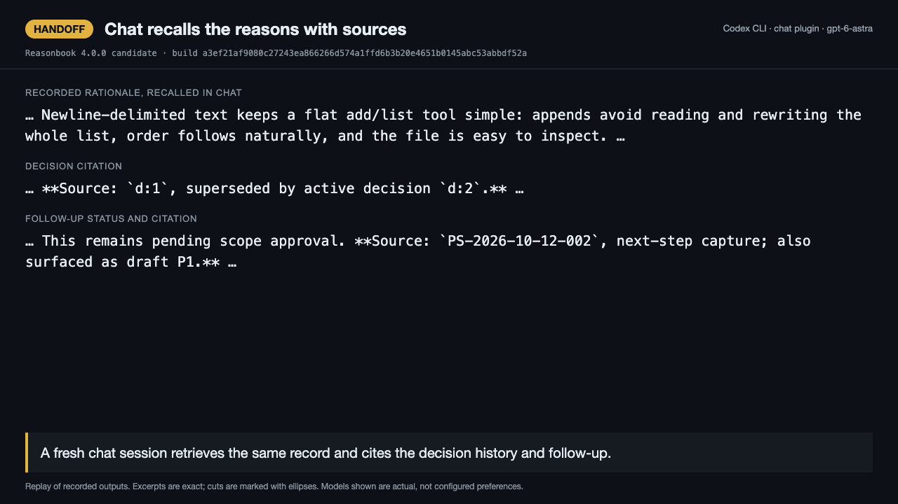
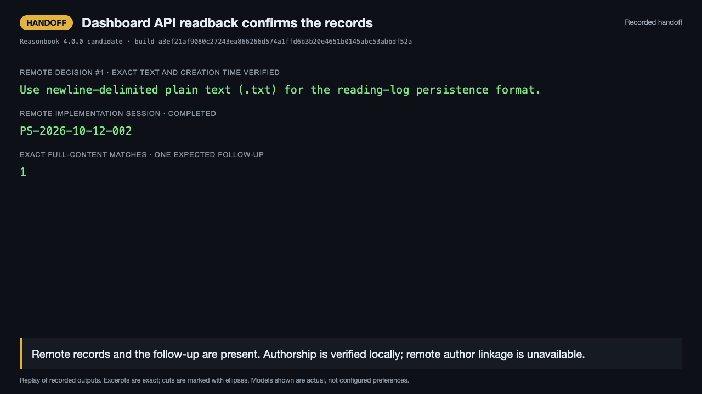

# The handoff demo

A 75-second replay of three recorded runs from 2026-10-12 on the Reasonbook 4.0.0 candidate.
Claude Code saves a choice, Codex retrieves and corrects it before implementing the tool,
and the chat plugin explains the result from the saved record. The final frame shows a live
dashboard API readback of that same disposable project.

[](reasonbook-handoff.mp4)

- [Video](reasonbook-handoff.mp4): MP4, 75 seconds, 1280×720, with visible captions.
- [Animated preview](reasonbook-handoff.gif): GIF, 75 seconds, 960×540. It loops; use the video to pause.

## What was verified

The candidate build is `a3ef21af9080c27243ea866266d574a1ffd6b3b20e4651b0145abc53abbdf52a`.
Claude Code 2.0.76 selected `claude-opus-4-5-20251101`; both Codex CLI 0.160.1 runs selected
`gpt-6-astra`. The developer and chat plugins were installed separately from the same candidate.
All three runs made successful `rbook_*` calls using the client's working directory to select
the record. The reading-log tests passed all six cases, with no failures or skips, including an
independent rerun after implementation.

The dashboard API returned matching project and record identifiers, decision text and creation
time, the completed implementation session, and an exact full-content match for the saved
follow-up. Its decision author linkage was unavailable. Harness attribution is verified by the
local tool receipts; this frame is API evidence, not a screenshot of the dashboard interface.

This is an excerpted replay. Displayed text comes from sealed tool/model/test/API receipts;
ellipses mark cuts, and the captions describe those receipts. The transcript below includes the
same excerpts. Five model starts were logged for this mission: one earlier Claude run, one
stopped developer attempt, and the three successful runs shown here. The earlier attempt is
preserved and supplies no frames in this recording.

## Stills









## Embedding

Use controls and omit autoplay so the video can be paused:

```html
<video
  src="reasonbook-handoff.mp4"
  poster="reasonbook-handoff-title.png"
  controls
  preload="metadata"
  width="1280"
>
  A 75-second recorded handoff. The transcript is at docs/demo/README.md.
</video>
```

GIF alt text: "A 75-second replay: Claude Code saves a choice, Codex corrects and implements it,
and the chat plugin recalls the saved reasons and follow-up; dashboard API readback confirms the records."

## Transcript

## A decision, ready for the next session

A real handoff in a disposable reading-log project.

## Claude Code records the choice

Claude chooses a plain text file and saves the reason in the project record.

rbook_decisions · recorded decision text

```text
Use newline-delimited plain text (.txt) for the reading-log persistence format.
```

Saved tool response

```text
Recorded decision #1
```

## The constraints stay with the choice

The saved record carries the constraints and a format limitation into the next session.

Recorded constraints

```text
The CLI must be dependency-free, preserve insertion order, and handle titles with spaces. …
```

Recorded limitation

```text
… Trade-off: embedded newlines in titles would corrupt the file …
```

## Codex retrieves and refines the decision

Codex keeps the format, records a correction as d:2, and preserves d:1 in the history.

rbook_decisions · retrieved d:1

```text
Use newline-delimited plain text (.txt) for the reading-log persistence format.
```

rbook_decisions · new correction d:2

```text
Keep d:1's newline-delimited UTF-8 .txt format, but reject empty or whitespace-only titles and titles containing CR or LF before appending. Treat persistence as sequential single-user storage, without record-level atomicity or crash-recovery guarantees.
```

Saved tool response

```text
Recorded decision #2
```

## Implementation, checks, and a follow-up

Six tests pass with none skipped. A proposed next step is saved for later review.

Final developer test run

```text
… ℹ pass 6
ℹ fail 0
ℹ cancelled 0
ℹ skipped 0 …
```

rbook_session · saved proposed follow-up

```text
Proposed follow-up, pending operator scope approval: add an optional --file PATH argument so the same reading log can be used from different working directories, retaining reading-log.txt in the current directory as the default. …
```

## Chat recalls the reasons with sources

A fresh chat session retrieves the same record and cites the decision history and follow-up.

Recorded rationale, recalled in chat

```text
… Newline-delimited text keeps a flat add/list tool simple: appends avoid reading and rewriting the whole list, order follows naturally, and the file is easy to inspect. …
```

Decision citation

```text
… **Source: `d:1`, superseded by active decision `d:2`.** …
```

Follow-up status and citation

```text
… This remains pending scope approval. **Source: `PS-2026-10-12-002`, next-step capture; also surfaced as draft P1.** …
```

## Dashboard API readback confirms the records

Remote records and the follow-up are present. Authorship is verified locally; remote author linkage is unavailable.

Remote decision #1 · exact text and creation time verified

```text
Use newline-delimited plain text (.txt) for the reading-log persistence format.
```

Remote implementation session · completed

```text
PS-2026-10-12-002
```

Exact full-content matches · one expected follow-up

```text
1
```
